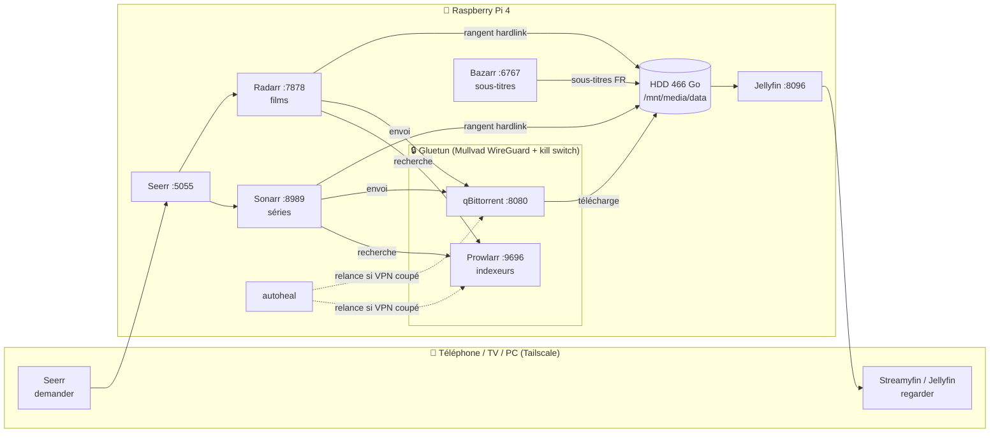

# 🎬 HouseFlix

Serveur multimédia auto-hébergé sur un Raspberry Pi 4 : on demande un film ou une série depuis son téléphone, il est récupéré automatiquement **derrière un VPN**, rangé, sous-titré, puis regardable partout (y compris hors ligne) **sans aucun port ouvert sur la box**.

> ⚖️ La stack est un outil. Ne l'utilise que pour du contenu que tu as le droit de télécharger (domaine public, licences libres, tes propres copies…). Un VPN protège ta vie privée, il ne rend pas légal le téléchargement d'œuvres protégées.

## En une image

## Les briques

| App | Rôle | Port | Passe par le VPN |
|---|---|---|---|
| **Gluetun** | Tunnel WireGuard Mullvad + pare-feu interne (kill switch) | — | c'est le VPN |
| **qBittorrent** | Client torrent, attaché à `tun0` uniquement | 8080 | ✅ |
| **Prowlarr** | Gère les indexeurs, les pousse vers Sonarr/Radarr | 9696 | ✅ |
| **Sonarr** | Séries : cherche, envoie au téléchargement, renomme, range | 8989 | — |
| **Radarr** | Pareil pour les films | 7878 | — |
| **Bazarr** | Sous-titres automatiques (français) | 6767 | — |
| **Jellyfin** | Serveur de lecture (type Netflix) | 8096 | — |
| **Seerr** | Interface de demandes (successeur d'Overseerr/Jellyseerr) | 5055 | — |
| **autoheal** | Relance qBittorrent/Prowlarr si le VPN a redémarré | — | pas de réseau |
| **Tailscale** | Accès distant chiffré, installé sur l'hôte | — | — |

## Documentation

- 📱 [Utilisation au quotidien (téléphone, TV, hors ligne)](docs/utilisation.md)
- 🏗️ [Architecture et fonctionnement détaillé](docs/architecture.md)
- 🔒 [Réseau et sécurité](docs/securite.md)
- 🎚️ [Qualité, langues et sous-titres](docs/qualite-langues.md)
- 🛠️ [Entretien, sauvegardes et dépannage](docs/entretien.md)
- 🚀 [Réinstaller de zéro](docs/installation.md)

Fichiers de config : [`docker-compose.yml`](docker-compose.yml) et [`.env.example`](.env.example).

## Matériel

- Raspberry Pi 4 Model B, 4 Go, Raspberry Pi OS 64 bits (Debian 12 bookworm)
- Disque WD Elements 466 Go en ext4, monté par UUID sur `/mnt/media`
- Configs des apps sur la carte SD (`~/houseflix/config`)
- Connexion en Wi-Fi, IP réservée `192.168.1.50` sur la box
