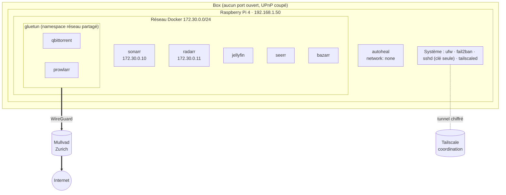

# 🏗️ Architecture

## Vue d'ensemble

Tout tourne dans Docker sur le Pi, décrit par un seul [`docker-compose.yml`](../docker-compose.yml). Tailscale est installé directement sur le système (pas en conteneur).



## Le chemin d'une demande

1. **Seerr** reçoit la demande et la transmet à **Sonarr** (série) ou **Radarr** (film) avec le profil choisi (`HD-1080p` par défaut, `4K` à la demande).
2. Sonarr/Radarr interrogent **Prowlarr**, qui interroge les indexeurs configurés. Prowlarr est dans le namespace réseau de Gluetun : **ses recherches sortent par Mullvad**.
3. Chaque résultat reçoit un score (qualité + langue, voir [qualite-langues.md](qualite-langues.md)). Le meilleur est envoyé à **qBittorrent** avec une catégorie (`tv` ou `movies`). Le fichier `.torrent` est récupéré par Prowlarr (option *Redirect* désactivée), donc lui aussi via le VPN.
4. **qBittorrent** télécharge dans `/data/torrents/<catégorie>`. Il est lié à l'interface `tun0` : sans tunnel, il n'a aucun réseau.
5. À la fin, Sonarr/Radarr **importent** le fichier dans `/data/media/tv` ou `/data/media/movies` par **hardlink** : pas de copie, pas d'espace doublé, et le torrent continue de partager.
6. **Bazarr** voit le nouveau fichier et cherche des sous-titres français.
7. **Jellyfin** scanne la bibliothèque, **Seerr** passe le titre en *Disponible*.

## Le VPN et le kill switch

- **Gluetun** monte un tunnel WireGuard vers Mullvad et applique son propre pare-feu : tout ce qui n'est pas le tunnel (ou le LAN/réseau Docker autorisés via `FIREWALL_OUTBOUND_SUBNETS`) est bloqué.
- **qBittorrent** et **Prowlarr** utilisent `network_mode: service:gluetun` : ils n'ont *pas* d'interface réseau propre. Si Gluetun s'arrête, ils n'ont plus que `localhost`. Testé : DNS et connexion directe à `1.1.1.1` échouent → **aucune fuite possible**.
- Leurs interfaces web sont publiées via Gluetun (ports `8080` et `9696`).
- Serveurs Mullvad épinglés (`VPN_HOSTNAMES`) : seuls certains serveurs suisses répondaient de façon fiable depuis cette connexion. L'IP de sortie reste ainsi stable.
- Mullvad ne fait plus de redirection de port : qBittorrent n'est pas « connectable ». Le téléchargement marche, le partage est un peu moins efficace.

### Pourquoi des IP fixes pour Sonarr et Radarr ?

Prowlarr vit dans le namespace de Gluetun, dont le DNS (DoT vers Mullvad) ne connaît pas les noms de conteneurs Docker. Sonarr et Radarr ont donc des IP fixes (`172.30.0.10` / `.11`) déclarées en `extra_hosts` sur Gluetun, pour que Prowlarr les joigne par leur nom. Dans l'autre sens, Sonarr/Radarr joignent Prowlarr et qBittorrent via `gluetun:9696` et `gluetun:8080`.

### Auto-réparation

Quand Gluetun redémarre, les conteneurs qui partagent son réseau perdent leur connexion. Chacun a un **healthcheck** (`curl https://1.1.1.1` chaque minute) ; après 3 échecs il passe *unhealthy* et **autoheal** le redémarre. Rétablissement automatique en 3 à 4 minutes. autoheal n'a pas de réseau, seulement le socket Docker en lecture seule.

## Stockage

```
/mnt/media/data            ← disque externe ext4, monté par UUID (fstab, nofail)
├── torrents/
│   ├── tv/                ← téléchargements qBittorrent (catégorie tv)
│   └── movies/
└── media/
    ├── tv/                ← bibliothèque Séries (Sonarr, Jellyfin, Bazarr)
    └── movies/            ← bibliothèque Films (Radarr, Jellyfin, Bazarr)

~/houseflix/config/<app>   ← configs et bases SQLite, sur la carte SD
```

- **Un seul volume `/data`** monté dans qBittorrent, Sonarr, Radarr et Bazarr : c'est ce qui rend les hardlinks possibles (même système de fichiers, même chemin vu de chaque conteneur).
- Jellyfin ne voit que `/data/media`, **en lecture seule**.
- Les configs sont sur la SD et pas sur le disque : les bases SQLite n'aiment pas les disques USB lents.

## Accès distant

- **Tailscale** (WireGuard maillé) : le Pi rejoint ton réseau privé Tailscale. Tes appareils l'atteignent par `raspberrypi` (MagicDNS) où qu'ils soient. Aucun port ouvert sur la box, rien d'exposé sur Internet.
- Le VPN Mullvad (dans Gluetun) et Tailscale (sur l'hôte) sont indépendants : Mullvad ne concerne que qBittorrent/Prowlarr.

## Pourquoi ces choix

| Choix | Raison |
|---|---|
| Jellyfin plutôt que Plex/Emby | Gratuit, open source, aucun compte en ligne requis |
| Seerr | Successeur commun d'Overseerr et Jellyseerr, intégré à Jellyfin |
| Prowlarr | Un seul endroit pour les indexeurs, synchronisés vers Sonarr/Radarr |
| Gluetun + Mullvad WireGuard | Kill switch au niveau réseau, pas seulement dans l'appli |
| Tailscale plutôt que redirection de ports | Zéro surface exposée sur Internet |
| ext4 | Permissions Linux et hardlinks fiables (NTFS non) |
| 1080p par défaut | Le Pi 4 ne transcode pas ; 4K réservée aux appareils qui lisent en direct |
